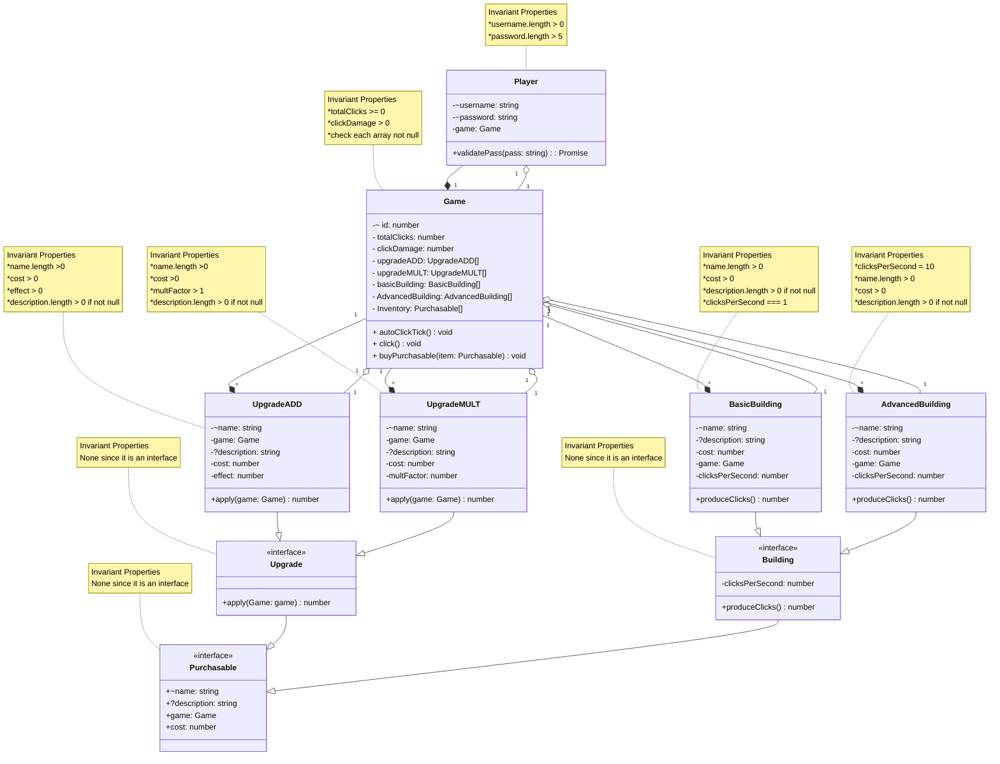

----
title: Domain Model for my clicker project
author: Mahmudl (mahmudl@myuamnitoba.ca)
date: Winter 2026
---

# Domain Model
Changes in the domain model since phase 1:

*Player class has been added for account management.

*Game class has id included and the buildings upgrade included.

*Game class has made all the upgrades made into array so it can be made
into more distinct upgrades later on if needed.

*Purchasable interface has been added on upgrades and buildings.

*2 types of buildings such as basic building and advanced building 
has been added.

*Relationships has been updated to include back referencing and cardinality.
restraints have been added on certain variables.

*Invariant properties have been updated.

