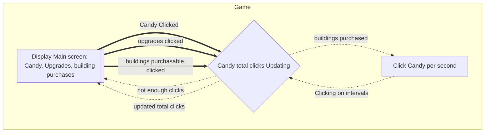
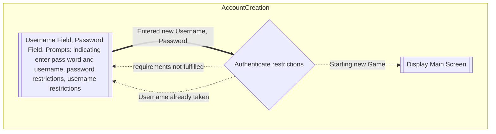
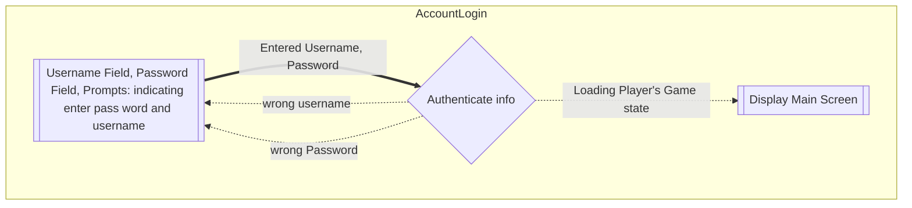
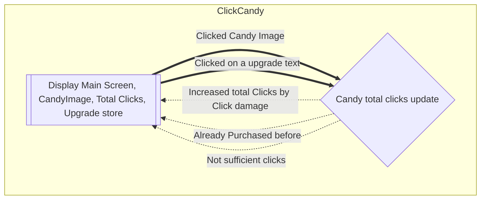

----
title: Flows of interaction for my clicker project
author: Mahmudl (mahmudl@myuamnitoba.ca)
date: Winter 2026
---
# Flows of interaction
Changes since phase 1:

*Account creation and account login interaction made

*Game chart have been updated to include autoclicking
### Phase 2

### Updated after feedback Phase 1
